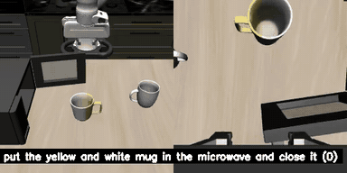
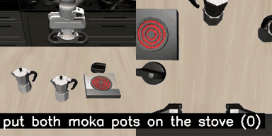
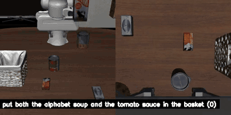
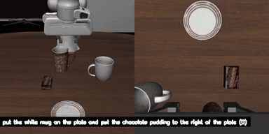

# SNOW

| **Mug into microwave** | **Moka pots on stove** |
| --- | --- |
|  |  |
| **Soup and sauce into basket** | **Mug and pudding arrangement** |
|  |  |

*LIBERO simulation rollouts. Click any animated preview to watch the original MP4.*

## Overview

SNOW is an experimental vision-language-action (VLA) project for robotic manipulation and motion learning. This repository includes training and inference code, dataset processing utilities, and simulation demos, with experiments on LIBERO, ACCAD, and BMLmovi.

## Main Results

Best recorded success rates for each LIBERO suite:

| Benchmark | Successful trials | Success rate | Experiment date |
| --- | ---: | ---: | --- |
| LIBERO-10 (Long) | 182 / 200 | **91.00%** | 2026-03-02 |
| LIBERO-Goal | 200 / 200 | **100.00%** | 2026-02-09 |
| LIBERO-Object | 200 / 200 | **100.00%** | 2026-02-09 |
| LIBERO-Spatial | 195 / 200 | **97.50%** | 2026-02-09 |

These results come from experiments on different dates. Training records and earlier evaluation results are listed in the [experiment log](#experiment-log).

## Experiment Log

### Training Runs

All runs below were recorded at **30,000 training steps**.

| Date | Dataset | Configuration | Training loss |
| --- | --- | --- | ---: |
| 2026-01-30 | LIBERO-10 | 7 action dimensions | 0.04 |
| 2026-01-31 | ACCAD | Revised dataset; 30 action dimensions | 0.02 |
| 2026-01-31 | ACCAD | 7 action dimensions | 0.01 |
| 2026-02-09 | LIBERO | 7 action dimensions | 0.05 |
| 2026-02-14 | LIBERO-10 | Pre-training + post-training; 7 action dimensions | 0.03 |
| 2026-02-15 | LIBERO | Drift variant; 7 action dimensions | 0.03 |
| 2026-02-15 | LIBERO | Action horizon increased to 16; 7 action dimensions | 0.06 |
| 2026-02-17 | LIBERO | Qwen2.5-VL-3B; 7 action dimensions | 0.09 |
| 2026-02-23 | LIBERO | Qwen3-VL-2B; revised Flow Matching head; 7 action dimensions | 0.07 |
| 2026-02-24 | LIBERO | Qwen3-VL-2B; revised Flow Matching head; `input_embedding_dim=2048` | 0.06 |
| 2026-02-24 | LIBERO | Qwen3-VL-2B; revised Flow Matching head; `hidden_size=2048` | 0.06 |
| 2026-02-27 | LIBERO | Qwen3-VL-2B; revised backbone | 0.05 |
| 2026-02-27 | LIBERO | Qwen3-VL-2B; revised backbone; `select_layer=24` | 0.06 |
| 2026-03-02 | LIBERO | Qwen3-VL-2B; backbone pre-training; constant learning rate of 0.04 | 0.05 |
| 2026-03-02 | LIBERO | Qwen3-VL-2B; backbone post-training | 0.03 |
| 2026-03-11 | BMLmovi | Qwen3-VL-2B; pre-training + post-training; learning rate of 0.04 | 0.02 |

### Evaluation History

| Date | Benchmark | Successful trials | Success rate |
| --- | --- | ---: | ---: |
| 2026-02-09 | LIBERO-10 (Long) | 173 / 200 | 86.50% |
| 2026-02-09 | LIBERO-Goal | 200 / 200 | 100.00% |
| 2026-02-09 | LIBERO-Object | 200 / 200 | 100.00% |
| 2026-02-09 | LIBERO-Spatial | 195 / 200 | 97.50% |
| 2026-02-14 | LIBERO-10 (Long) | 177 / 200 | 88.50% |
| 2026-03-02 | LIBERO-10 (Long) | 182 / 200 | 91.00% |

### Observations

- **2026-01-30:** Dataset actions appeared noisy, with a higher training loss.
- **2026-01-31:** The 7-dimensional ACCAD run had a lower training loss than the 30-dimensional run.
- **2026-02-09:** Training with more datasets improved performance in simulation.
- **2026-02-14:** Pre-training followed by post-training reduced training loss.
- **2026-02-15:** The Drift variant recorded a simulation success rate of 0.0 despite a training loss of 0.03. Its implementation needs revision.
